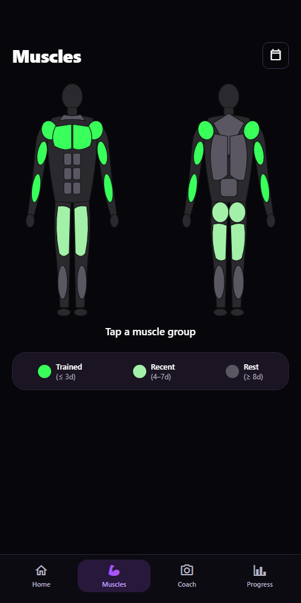
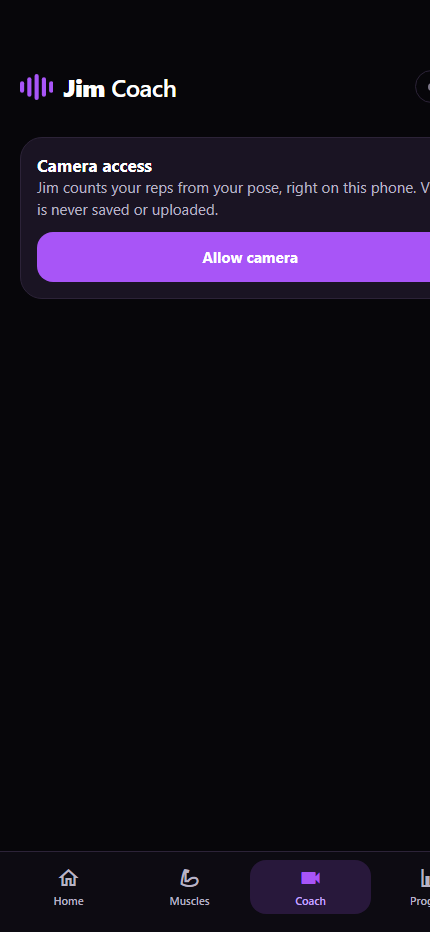

# JimBro

**An adaptive AI training system that turns ordinary phone video into measurable exercise data,
then uses that data to personalize your next workout.** Built at HackPrinceton Fall '26
(Healthcare track).

Many people skip the gym because they're anxious about being judged by a coach or a crowd. JimBro
is a private coach in your pocket. Jim watches your set through the phone camera, counts only real
reps, tells you why one didn't count, plans your next session from your history, and runs it with
you hands-free. Video never leaves the phone.

| Home | Muscles | Progress | Coach |
|---|---|---|---|
|  |  |  |  |

## Try it in a minute
```bash
cd apps/expo
npm ci
npx expo start --web     # opens in your browser; the Coach camera works in Chrome
npx expo start           # or scan the QR code with Expo Go on your phone (same Wi-Fi)
```
Then tap **"I have 20 minutes, help me finish chest day"** on Home.

## What it does
- **Workout Mission.** Say how long you have and what to train. Jim plans a session that fits the
  time, using your goal, your history and which muscles are rested. He explains every pick and
  waits for you to tap Start. He then runs the session: each set starts when the camera sees you
  and ends when you stop, a quick effort check follows, and rest is counted down with the next
  set's adjustment. If the camera can't track a lift, he offers a lift it can count. At the end he
  checks the result against the plan.
- **Camera rep counting** for curl, squat, shoulder press and push-ups (standard, knee and
  incline), using MediaPipe pose on the phone or in the browser. Only real reps count. Arm swing,
  joints that jump, leaving the frame and gesturing are not counted, and Jim says why
  (**"Caught it"**). He notices when you switch lifts and offers to switch the set.
- **Set report** for each set: reps counted and not counted (with reasons), rep times, tempo,
  tracking quality and an effort estimate (RPE / reps in reserve from rep speed, labelled as an
  estimate). **Form review** replays your skeleton next to the ideal movement with a cue to fix.
- **Jim, your coach**, in five personas (Coach, Hype, Sergeant, Zen, Data). The numbers are the
  same; only the wording and voice change. Chat with him, or use Talk mode. With the optional AI
  proxy he answers through Claude; without it, built-in rules answer offline. Claude can only
  *propose* changes to your log, and you confirm each one.
- **Plans and goals.** First-run setup asks your experience, fitness goal and what you want to
  look like. Rest times are set per exercise and goal, with the reason shown. Goals cover
  strength, consistency, volume and camera-verified reps, with a weekly check-in.
- **Progress.** Total strength (estimated 1RM), volume, PRs, workout history, and
  workout/month/year comparisons. A muscle map shows what you trained recently.
- **Bring your data.** Import past workouts from CSV or Excel. Import an Apple Health export to
  estimate your activity level. Optionally, plan toward a reference physique photo, sent only
  after you tick consent.

## Evidence (real and simulated kept apart)
- **Real video**, replayed through the production pose pipeline (`tools/vision-lab`): 4 labeled
  clips. All 3 real reps were counted, and 0 fake reps on 2 clips of someone talking and gesturing.
  One of those is held out: we never tuned on it, and it went from 5 fake reps to 0 after the
  torso-in-frame check.
- **Simulated** landmark sets (seeded): 20/20 reps on 20-rep sets for each lift, and push-up type
  480/480 per variant. These are simulations, not real-world accuracy.
- Tests: app 402, vision lab 44, AI proxy 26, all passing. Details in
  [docs/EVIDENCE.md](docs/EVIDENCE.md) and [docs/AUDIT.md](docs/AUDIT.md).

## Privacy
- Video is never stored or uploaded. Pose is found on the device, and only body landmarks reach
  the app's logic.
- Workouts are stored on the phone (AsyncStorage), with no account. Export or erase them in the
  🔔 sheet.
- The optional AI proxy receives a text summary only (recent sets, records, goals and the last set
  report), never video, names or workout ids. Pain or dizziness gets a fixed safety reply before
  any network call.
- The one exception: a reference physique photo you pick is sent for that single request, only
  after an explicit consent tick. It is never stored or logged, and replies never judge weight,
  looks or health.


## Shared team preview (phones, no laptop)

[](https://expo.dev/accounts/slaterr/projects/jimbro/branches/preview)

Scan with your phone camera to open the persistent Expo preview page, then select the latest update. This is a dashboard QR, not a temporary laptop tunnel or a direct installation QR. Sign in if prompted.

[Open latest preview](https://expo.dev/accounts/slaterr/projects/jimbro/branches/preview) · [Install a build](https://expo.dev/accounts/slaterr/projects/jimbro/builds) · [CI status](https://github.com/slaterrr/JimBro/actions/workflows/ci.yml)

Install a compatible preview build on each phone once. It receives the `preview` channel without a laptop server. After publishing, launch the app to download the update, then fully close and reopen it to apply it. Default behavior can require two launches. Each phone keeps its own workout records.

#### One-time activation

The Expo project is linked. Add an Expo access token as the GitHub Actions repository secret `expo_access_token`. Never put tokens in source code or chat. Create and install the first preview build:

```bash
cd apps/expo
npx eas-cli@latest login
npx eas-cli@latest build --profile preview --platform android
# For iPhones use --platform ios; Apple signing and registered devices are required.
```

Follow build prompts for application identifiers and signing. JavaScript updates cannot add native modules to an installed build. Rebuild after native dependency/configuration changes and increase the app version when changing the native runtime. Updates use the `appVersion` runtime policy.

#### Team workflow

1. Branch from current main, develop locally, and open a pull request.
2. Pass CI and review, then merge into main.
3. The main CI run publishes to `preview` only after all quality jobs pass. PRs never publish to this shared channel.
4. Check Actions and the preview page, then reopen the installed app.

EAS Update publishes JavaScript and bundled assets. The optional AI proxy is deployed separately; updates do not synchronize workout data.

## Repository
| Path | What |
|---|---|
| [`apps/expo`](apps/expo/README.md) | The JimBro app (Expo SDK 58, phone and web). **Start here.** |
| [`server/jim-proxy`](server/jim-proxy/README.md) | Optional AI proxy. It holds the Claude API key so the app never does, and stores nothing |
| [`tools/vision-lab`](tools/vision-lab/README.md) | Replays labeled videos through the real pose pipeline and scores the rep counter |
| `apps/mobile`, `backend/` | The earlier browser app and Raspberry Pi server (paused). See [docs/PI.md](docs/PI.md) |
| [`docs/`](docs) | Audit, Devpost draft, evidence, design screenshots |

## Limitations (honest)
- Real labeled data is small (4 clips). The 20-rep results are simulated. Latency was measured on
  a desktop CPU, not a phone.
- Counting works best side-on, with your whole body (or upper body, for curls and presses) in
  frame. Front-on curls can't be counted, and front-view push-ups aren't handled.
- Bench press, deadlift, pull-ups and lunges are logged by tapping, not counted by the camera.
- Effort (RPE) and form checks are uncalibrated heuristics on landmarks, not measurements and not
  medical advice. 1RM is an estimate (Epley).
- Expo Go has no speech-to-text, so Talk mode uses the keyboard's dictation.
