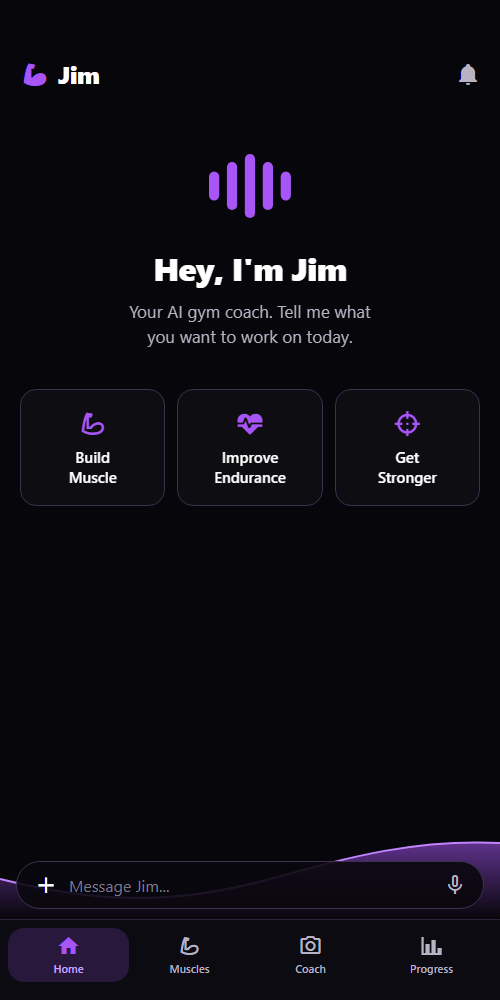
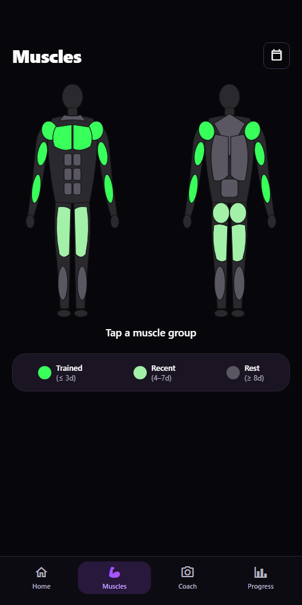
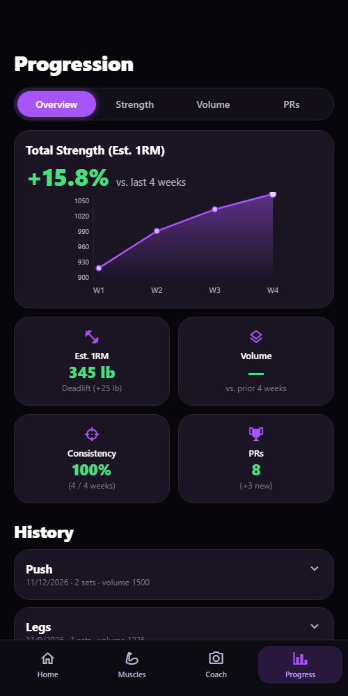
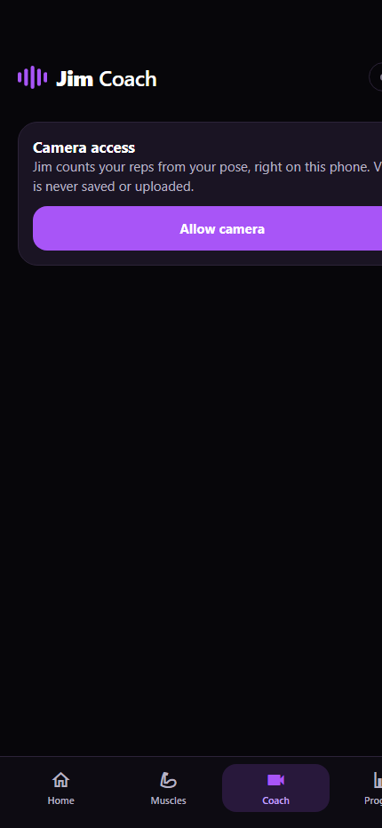

# JimBro app (Expo)

The JimBro app (Expo SDK 58), with four screens: Home · Muscles · Coach · Progress. It runs
**entirely on your phone**, or in a laptop browser, with no server and no account. Workouts are
stored with AsyncStorage and never uploaded.

| Home | Muscles | Progress | Coach |
|---|---|---|---|
|  |  |  |  |

(Web-preview screenshots with sample data.)

## Run it
```bash
cd apps/expo
npm ci
npx expo start           # scan the QR code with Expo Go (same Wi-Fi as your computer)
npx expo start --web     # or run it in the browser on http://localhost:8081
```
If local networking fails, try `npx expo start --tunnel`. In the browser, the Coach camera works
in Chrome after you allow camera access. The first run needs internet to download the pose model.
The layout fits screens from 320 px phones to desktop, where the app sits in a centered column.

## Screens
- **Home (Jim):** "Hey, I'm Jim" with **Start a Workout** (the next day of your plan, opened on
  Coach), **Create a New Plan** (pick a goal and tune days, minutes and equipment, or import past
  workouts) and **Review My Progress**. A weekly health card shows sessions, camera-verified reps
  and your next step.
  - **Workout Mission:** type or tap *"I have 20 minutes, help me finish chest day"*. Jim plans a
    time-boxed session from your history and goal, explains each pick, and starts only when you
    tap Start.
  - Chat with Jim in one of five personas (Coach, Hype, Sergeant, Zen, Data). Typing "10 curls at
    20 pounds" logs a set after you confirm it.
  - **+** opens *Log a set* (Jim's hint, plate calculator, RPE, 🏆 record detection, rest timer).
  - Pain or dizziness always gets the same safety reply.
- **Muscles:** front and back body map coloured by when each group was last trained (≤3 days,
  4–7 days, ≥8 days). Tap a group to see its recent work and log a lift that trains it. The
  calendar opens your history.
- **Coach (live):** the camera counts reps for curl, squat, shoulder press and push-ups (standard,
  knee and incline). It runs MediaPipe in a WebView on phones and in an iframe on web, and video
  never leaves the device.
  - It shows *Set x of y*, *Reps n / target*, an effort estimate, and Jim's live cue.
  - Movements that aren't counted get a **"Caught it"** badge with the reason (arm swing, out of
    frame, tracking jumped). Jim tells you which body part to bring back into frame.
  - Switching lifts mid-set is detected, and Jim offers to switch.
  - After each set: a set report (counted and not-counted reps, rep times, tempo, tracking quality)
    and **form review** (your skeleton replayed against the ideal movement, with why, fix and cue).
    These are side-view checks on body landmarks, not medical advice.
  - During a **Workout Mission**, the Coach tab runs the session hands-free:
    - each set starts when you're in frame and ends after you stop;
    - a quick effort check follows (it saves itself), then rest with a countdown;
    - Jim offers a camera-counted lift when the planned one can't be tracked;
    - a summary is checked against the plan.
  - Bench press, deadlift, pull-ups and lunges are counted by tapping.
- **Progress:** *Overview* has workout, month and year comparisons and Total Strength (sum of each
  lift's best estimated 1RM, vs. the last 4 weeks) with a chart. *Strength* shows top weight per
  exercise, *Volume* weekly bars, *PRs* records with estimated 1RM, *History* every workout, and
  *Goals* your goals with a weekly check-in and your activity level from a health import.

First-run setup asks your experience, main fitness goal and, optionally, what you want to look
like. Pain answers lead to safety text instead of a plan. Rest times are not a setting: they come
from the exercise, your goal and your last effort, and the reason is shown.

The 🔔 sheet holds your weekly goal and streak, recent records, the setup questions, settings
(persona, voice, units, weekly goal) and your data (export, restore by pasting an export, erase).

## Jim AI (optional)
Run `server/jim-proxy` (see its README) and start the app with
`EXPO_PUBLIC_JIM_PROXY_URL=http://<laptop-LAN-IP>:8787 npx expo start` (or set
`expo.extra.jimProxyUrl` in `app.json`). Jim then answers through Claude, and the header badge
shows **AI**. Without a URL, or if the proxy fails, it shows **offline** and uses the built-in
rules.
- Only a text snapshot is sent: the last 14 days of sets, records, goal progress, weekly check-in,
  last camera set report, unit and persona. Never video, names or workout ids.
- Claude can only *propose* log/fix/delete changes. The app re-validates them and you confirm on
  the usual card.
- A reference physique photo goes to the proxy only after you tick consent, for that one request.
  It is never stored.
- Pain or dizziness gets the fixed safety reply before any network call.

**Talk mode** (header button): Jim speaks every reply in the persona's voice and reopens the
keyboard when he finishes. Dictate with the keyboard's mic, and the text is sent after about 2 s
of silence. Expo Go has no speech-to-text API, so the keyboard mic is still one tap per turn.

## How it works
`src/lib` holds the tested logic (run `npm test`):

| Area | Modules |
|---|---|
| Camera pipeline | `poseHtml.js` (MediaPipe page), `poseBridge.js` (web messages), `angles.js`, `live.js`, `reps.js`, `guidance.js`, `switchExercise.js` |
| After a set | `sessionReport.js`, `effort.js`, `form.js` |
| Jim | `coach.js`, `cues.js`, `personas.js`, `jimAI.js`, `intents.js`, `parse.js`, `speech.js`, `sound.js`, `voice.js` |
| Sessions and plans | `mission.js`, `plans.js`, `planFromGoal.js`, `rest.js`, `homeActions.js`, `onboarding.js`, `fitnessGoal.js` |
| Progress and goals | `progress.js`, `stats.js`, `compare.js`, `comparison.js`, `goals.js`, `healthSummary.js`, `muscles.js` |
| Your data | `importWorkouts.js`, `healthData.js`, `activityLevel.js` |
| UI rules | `layout.js` (screen sizes), `palette.js` (contrast), `exercises.js`, `tools.js` |

The UI is in `src/screens` and `src/components`, with design tokens in `src/theme.js`.
`components/PoseView.js` is the phone camera view and `PoseView.web.js` the browser one.

Not a medical device. 1RM is an estimate (Epley). Effort (RPE) is estimated from rep speed and is
uncalibrated. The first browser prototype is kept in `legacy-web/` for reference.
