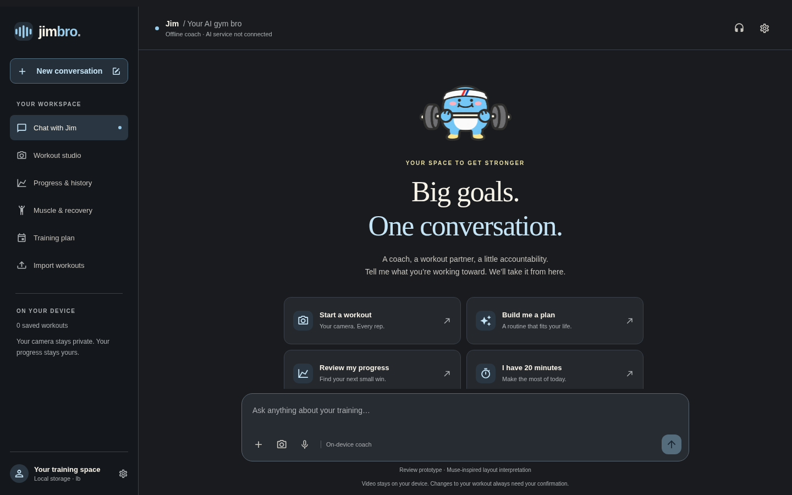
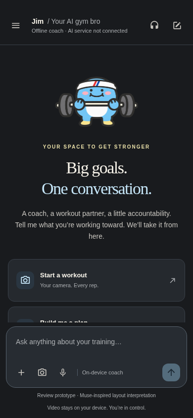

# JimBro review prototype

Branch: `feat/chat-mvp-review` · Worktree: `/workspace/JimBro-review`.

The existing `codex/chat-mvp` prototype was rebased onto the current-main snapshot
`fca85e0` in this separate worktree. Local `main` and the original checkout remain
unchanged. No PR was merged, no deployment was made, and no shared Expo update was
published.

## Review the web app

The Cloud-local dev server is running at **http://localhost:8081**. That address is
inside the Cloud computer; it is not a publicly hosted teammate link. Open it in the
Cloud desktop's browser when available. This environment does not expose a browser
forwarding tool, so a direct URL in your own computer's browser is not established.

To run from this worktree:

```sh
cd /workspace/JimBro-review/apps/expo
npm ci
npm run preview:review
```

The usual `npx expo start --web` works too. On another computer, after the review
branch has been pushed, create an isolated checkout without switching its main:

```sh
cd JimBro
git fetch origin
git worktree add -b review-jimbro ../JimBro-review origin/feat/chat-mvp-review
cd ../JimBro-review/apps/expo
npm ci
npm run preview:review
```

Open the URL Expo prints. Create a **local review account**, then complete or skip
setup. The existing accounts are browser/device-local; this prototype does not add
server identity or cloud synchronization. Each account has its own local records.

## Suggested teammate walkthrough

1. Check the blue Jim mascot, graphite surfaces, cream text and pale-yellow accents
   on desktop and a narrow phone viewport. The Muse reference was not supplied, so
   the footer explicitly labels this layout as an interpretation.
2. Ask **Create a new plan**. Change goal/equipment/time, optionally request an AI
   preference pass, then explicitly save. The existing local plan remains the
   authority for exercises, sets, reps and rest.
3. Ask **I have 20 minutes, help me train arms**. Review the mission before starting.
4. Ask **Start a workout** or **Open the camera for squats**. Grant camera access.
   Camera tools appear inside chat, and the composer stays available.
5. Count a completed set with your whole body visible. Ask about the observed count,
   end the set, enter added load/optional effort, then confirm its save. Counts and
   timing are measured; weight and RPE are reported. Video is never recorded or
   uploaded. Without a physical camera, use the automated replay test, not invented
   reps.
6. During an explicitly started workout, ask **Log 8 squats at 20 kg**. Test Cancel,
   then repeat and Confirm. Try **Correct my last set to 9 reps** and **Delete my
   last set**; both need their own confirmation.
7. Finish the workout and open progress/history. Test comparisons and their Submit/
   back flow. Open the muscle map and drill into a group's exercise progress.
8. Open the menu/settings to change persona or speech preferences. Talk uses the
   existing keyboard dictation plus spoken replies, not streaming recognition.
9. Test import preview/confirmation. Reference-photo planning retains explicit
   consent for each photo request.
10. Refresh to verify local workout persistence; stop a pending reply or start a
    new chat to verify late results do not create a save card.

## Preserved teammate contributions

- #47/#55/#62: vision and coach engines, missions, retained chat, shared measured
  camera context, privacy and fallback behavior.
- #63/#65: workout-only logging, muscle-specific progress, local login and
  account-scoped storage, existing Playwright journeys.
- #67: explicitly requested, bounded AI plan personalization; its `/plan` endpoint
  and separate save action remain available in the chat plan tool.
- #70: trusted-ingress handling, production proxy-key guard, byte-based request
  limits, and comparison results navigation.

A pending log card is now tied to the workout that existed when it was proposed.
It cannot silently save into a new session. Confirmation also requires an explicitly
started workout. Camera save cards follow the same session rule.

## AI connection and test boundaries

The review preview uses the offline coach unless you configure the existing proxy.
No provider API key is bundled into the app. To enable live Claude, privately set
`ANTHROPIC_API_KEY` and `JIM_PROXY_KEY` for `server/jim-proxy`; set the matching
`EXPO_PUBLIC_JIM_PROXY_URL` and prototype access key in `apps/expo/.env`, and restart
Expo. Use the existing deployment guide only after team approval; this review does
not deploy anything. `CLAUD_TOKEN` in GitHub's smoke-test job is not a running API.

The interface reports offline, local-data and AI reply states separately. Tool calls
are allowlisted and independently validated. Persistent model proposals need an
unexpired, revalidated, one-use confirmation. Stop/pain interrupts a pending turn,
releases the camera and ignores late responses. No model call runs per pose frame.

## Validation

Actual checks in this environment:

| Check | Result |
|---|---|
| App engine/helper tests | 609 passed |
| Proxy/API tests | 51 passed |
| Vision lab tests | 51 passed |
| Chat/tool Playwright suite | 23 passed |
| Existing user journeys, adapted to inline tools | 16 passed |
| Android and iOS production exports | Both built |
| Actual dev preview: signup → skip setup → chat → inline progress → reload | Passed, no runtime errors |
| Shared palette text/action contrast | AA (≥ 4.5:1) across review surfaces |

Totals: **711 engine/helper/API tests and 39 browser scenarios passed**.
Keyboard checks include Shift+Enter for a newline and Enter submitting once.
Viewport checks cover 320, 390 and 1440 pixels. The pending-log/new-workout
regression first failed with an actual cross-session save, then passed after binding
cards to their workout.

Commands:

```sh
npm test --prefix apps/expo
npm test --prefix server/jim-proxy
npm test --prefix tools/vision-lab
cd apps/expo
npm run test:chat
CHROME_PATH=/usr/bin/chromium EXPO_NO_TELEMETRY=1 CI=1 npm run test:e2e
EXPO_NO_TELEMETRY=1 CI=1 npx expo export --platform android --platform ios --output-dir dist-native
```

Screenshots below are from the **actual offline dev preview**, after local signup
and dismissal of setup; they contain no invented workout history:





Generated test reports remain local in `apps/expo/e2e-artifacts/chat-mvp-report`
and `apps/expo/e2e-artifacts/playwright`. GitHub CI runs both browser suites with
independent exports so fixture API settings do not leak into offline journeys.

- Engine/helper/API tests use recorded and synthetic fixtures, as labeled by the
  original suites. They do not establish new physical-camera accuracy.
- Chat Playwright tests use the production HTTP server and tool loop with a
  deterministic **mocked Claude SDK**; no browser-only API replacement.
- One browser replay sends the existing real squat landmarks through the real
  iframe bridge and rep counter. Two measured reps reach Jim and persist with
  timing only after confirmation. This is **recorded-landmark replay**.
- The separate offline journeys exercise login/setup, mission/plan/history,
  comparisons, muscle progress, preferences and persistence.
- Live Claude reasoning and physical-device camera/speech quality remain untested
  in this environment. Existing analyzer limitations remain unchanged.

See `REVIEW_PR.md` for the draft review description and `CHAT_MVP.md` for the
original chat implementation details. The present review report supersedes that
older branch's palette, base revision and test-count notes.
